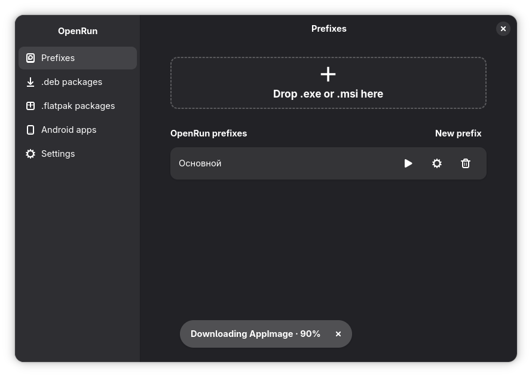
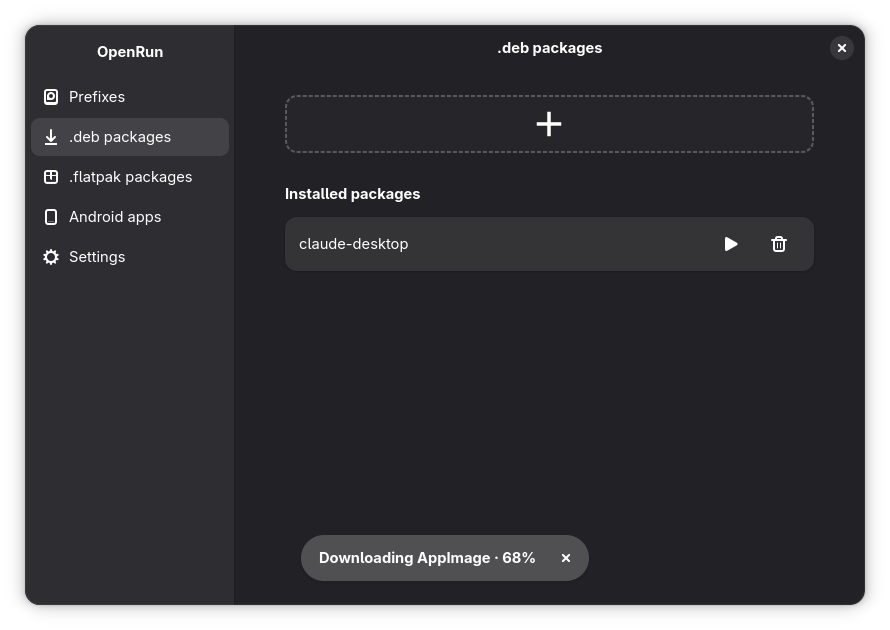
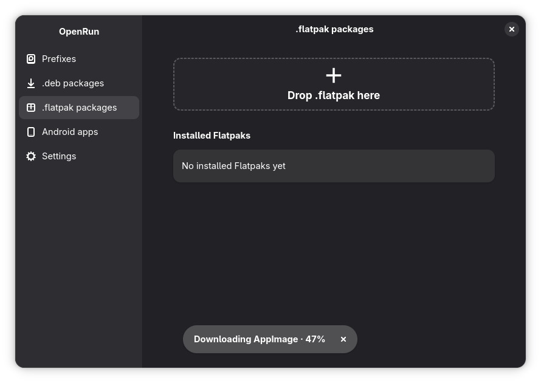
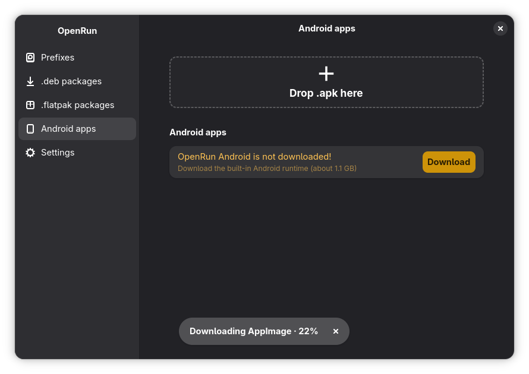

# OpenRun

[Русская версия](README.md)

OpenRun is a small Windows application manager for Linux. It keeps Wine
prefixes in one place, opens `.exe` and `.msi` files, installs local `.deb`
and `.flatpak` packages, and creates shortcuts so you can find programs in
the menu instead of digging through folders.

It is written in Rust with GTK4 and libadwaita, so it looks at home on GNOME.
On first launch it downloads its own Wine runtime. You do not need to install
Wine system-wide.

### Categories

<p align="center">
  
  
</p>
<p align="center">
  
  
</p>

## What it does

Double-click an `.exe`, `.msi`, `.deb`, `.flatpak`, or `.apk` and OpenRun takes
it from there: it opens the file, creates a prefix if needed, starts or installs
the program, and adds a shortcut. You do not have to launch OpenRun first.

You can also drag files into the window. Dropping them on the big plus in the
middle works too.

Prefixes can be created, started, configured, and removed from the list.
Removing an entry does not delete files from disk.

Launched `.exe` files are remembered. You can start them again, create a
shortcut, or forget the entry.

Local `.deb` packages are installed without `dpkg` and without root. OpenRun
reads the ar archive itself (it only needs `tar`/`xz`), extracts files to
`~/.local/share/openrun/deb`, rewrites `.desktop` files for the new paths, and
copies icons into the icon theme. This works on Arch, CachyOS, Debian, Ubuntu,
Pop!_OS, and other distributions.

`.flatpak` bundles are installed through the system `flatpak` into the user
installation. OpenRun remembers what it installed and creates a shortcut that
runs `flatpak run <id>`. The “`.flatpak` packages” page lets you launch or
remove them and drop new bundles there.

### Android apps

`.apk` files use the OpenRun Android runtime. The “Android apps” page can install
an APK, launch it, remove it, or create a shortcut. If the runtime is not
downloaded yet, the bottom of the page shows an “OpenRun Android is not
downloaded!” banner with a “Download” button. It downloads the AppImage and
system images (about 1.1 GB) to `~/.local/share/openrun/android`. The runtime
must be running; it needs Wayland and `binder` support in the kernel. Technical
detail: the runtime is currently based on Waydroid, so its system component has
to be installed once. A separate Wine or Android SDK installation is not
needed.

Settings include the theme (system, light, dark), language (Russian or English),
and a “Refresh” button that recreates shortcuts and the icon cache when
something goes missing after an update.

The window has a close button only, with no minimize or maximize. That is
intentional.

## Installation

### Prebuilt files

The easiest way is to grab a file from the releases page:

https://github.com/coztov-run/openrun/releases/latest

It has a portable `tar.gz`, a Flatpak bundle, and a Snap. Checksums are in
`SHA256SUMS`.

### Flatpak

Flatpak is the best choice on Pop!_OS, Ubuntu, Debian, Fedora, and most other
distributions: it brings its own libraries and does not depend on the system
GTK version.

```bash
flatpak install --user openrun-0.1.1-x86_64.flatpak
flatpak run io.github.coztov_run.OpenRun
```

OpenRun is not on Flathub yet. Once the submission is accepted, this will work:

```bash
flatpak install flathub io.github.coztov_run.OpenRun
```

### Snap

```bash
sudo snap install ./openrun_0.1.1_amd64.snap --classic --dangerous
openrun
```

It is not in the Snap Store yet either. Classic snaps go through manual review.
After publication, `sudo snap install openrun --classic` will be enough.

The snap uses classic confinement because OpenRun writes shortcuts to your home
directory, registers MIME handlers, and launches Wine. See
[`snap/README.md`](snap/README.md).

### Portable tarball

```bash
tar -xzf openrun-0.1.1-x86_64.tar.gz
cd openrun-0.1.1-x86_64
./install.sh
~/.local/bin/openrun
```

You need Linux x86_64, GTK 4.12+, libadwaita 1.5+, and glibc 2.39+. That means
Arch, CachyOS, Fedora 41+, Ubuntu 24.10+, and newer. On older systems, use the
Flatpak.

The installer puts the binary in `~/.local/bin`, the launcher in
`~/.local/share/applications`, and the icon in the icon theme. It also registers
OpenRun as a handler for `.exe`, `.msi`, `.deb`, `.flatpak`, and `.apk`.
Existing handlers stay as fallbacks.

To remove it:

```bash
./uninstall.sh
```

### From source

```bash
cargo build --release
cargo run
```

The first launch downloads the Wine runtime (about 100 MB) to
`~/.local/share/openrun/runtime`. After that it works offline.

Settings live in `~/.config/openrun`; prefixes, installed `.deb` files, and the
list of `.flatpak` bundles live in `~/.local/share/openrun`. Data from older
versions is migrated automatically.

## Double-click and shortcuts

OpenRun registers these MIME types:

- `application/x-msdownload`
- `application/x-ms-dos-executable`
- `application/vnd.microsoft.portable-executable`
- `application/x-msi`
- `application/vnd.debian.binary-package`
- `application/vnd.flatpak`
- `application/x-flatpak`
- `application/vnd.android.package-archive`

For `.exe` and `.msi` files you get
`~/.local/share/applications/openrun-app-*.desktop` plus a copy on the desktop.
For `.deb` packages, shortcuts are named `openrun-<package>-*.desktop`.
For `.flatpak` bundles they are named `openrun-flatpak-<id>.desktop`.
Android app shortcuts are named `openrun-android-<package>.desktop` and launch
OpenRun with `--launch-android`.

If a shortcut or icon does not show up, open Settings → “Shortcuts and icon
cache” → “Refresh”. That is usually faster than digging through logs.

Inside Flatpak, Windows application shortcuts run
`flatpak run io.github.coztov_run.OpenRun --launch-app "Name"` because the Wine
path inside the sandbox is not visible from the host.

## Building

```bash
# portable tarball
bash packaging/portable/build.sh

# Flatpak
flatpak-builder --user --install-deps-from=flathub \
  --repo=repo --force-clean build-dir \
  flatpak/io.github.coztov_run.OpenRun.yml
flatpak build-bundle repo openrun.flatpak io.github.coztov_run.OpenRun

# Snap
snapcraft pack --destructive-mode
```

On every `v*` tag, GitHub Actions builds the `tar.gz`, Flatpak, and Snap, writes
`SHA256SUMS`, and attaches everything to the release.

## About the stores

Flathub and the Snap Store are separate from GitHub Releases. A file on GitHub
does not appear in either store by itself: you have to submit it and wait for
review.

The submissions have not been sent yet. The Flathub files are ready in
[`packaging/flathub`](packaging/flathub/README.md), including the manifest,
`cargo-sources.json` for offline builds, and `flathub.json`. The pull request
has to be opened manually against `flathub/flathub`, branch `new-pr`; Flathub
does not allow automated submissions. For the Snap Store you need
`snapcraft login`, an upload, and approval of classic confinement.

That is why searching in Pop!_Shop and the Snap Store finds nothing right now.
It is not an installation problem — the app simply is not listed there yet.

## License

GPL-3.0-or-later. See [`LICENSE`](LICENSE).
